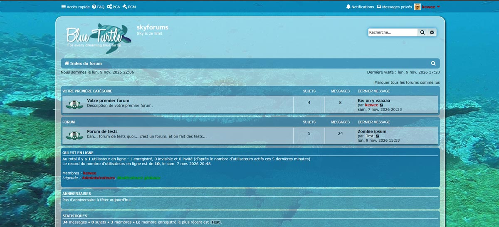

# Blue Turtle 🐢

A blue and aqua style for **phpBB 3.3**, inspired by Sting’s *The Dream of the Blue Turtles*.

Translucent panels reveal an underwater background, while custom turtle icons complete the theme.

## Features

- Inherits from prosilver.
- Custom CSS in a separate stylesheet.
- Custom forum icons.
- Translucent panels with improved readability.

## Downloads

Ready-to-install packages are available from the [Releases page](https://github.com/Kewee/phpbb-style-blueturtle/releases).

## Installation

Extract the release archive and copy the Blue Turtle folder containing `style.cfg` into your forum’s `styles` directory.

Install the style from the phpBB Administration Control Panel.

## Author

Created by **Kewee** — [CRI Studio](https://cristudio.fr/).

## License

GNU General Public License v2. See `license.txt` in the style folder.
